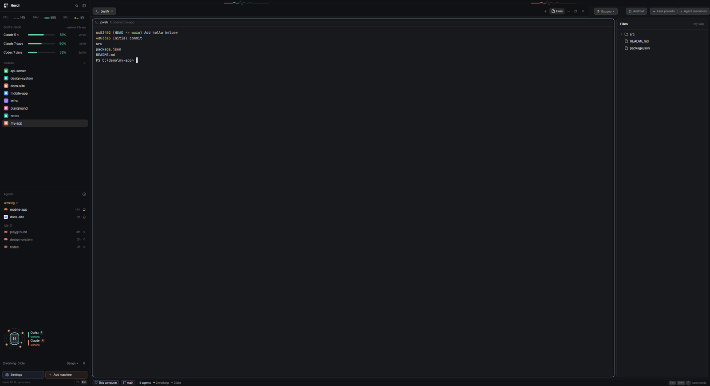
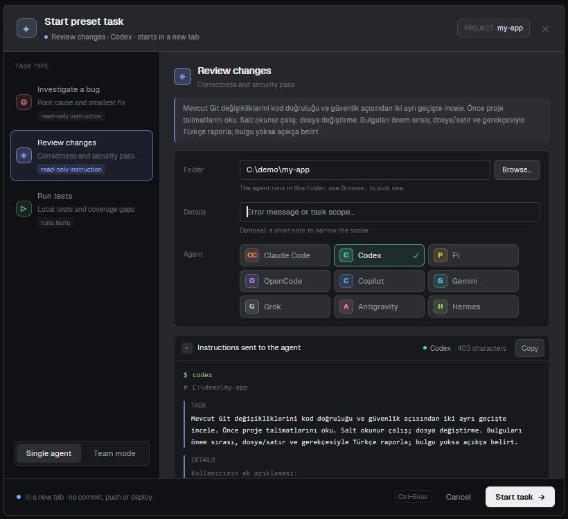
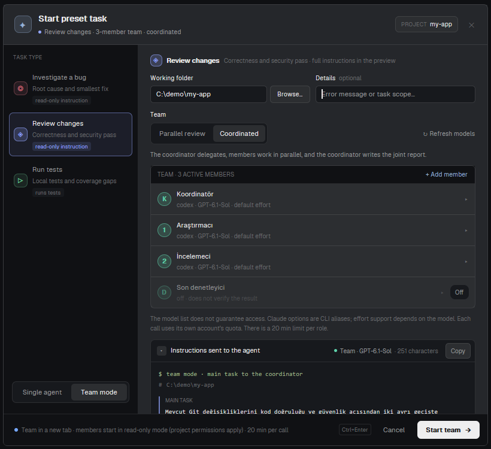
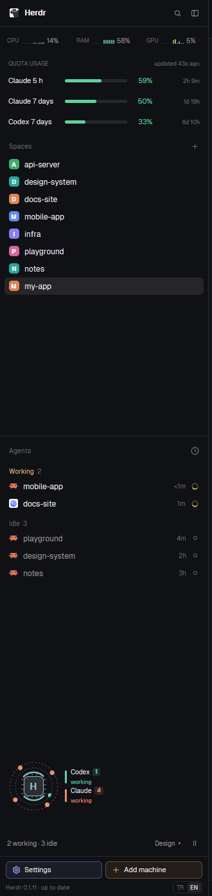
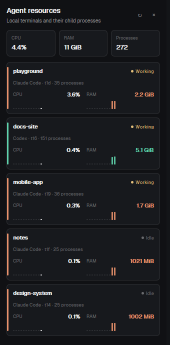
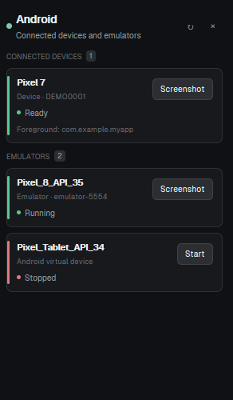
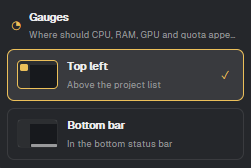

# Agent Workspace

A [Herdr](https://herdr.dev) layout for running several coding agents side by side: one sidebar with system and quota gauges, projects, agents sorted by who needs you, and an animated team pulse; a tab bar with launchers for Files, Agent resources, Android and ready-made agent tasks; and a status bar that counts agents by state. The interface is Turkish by default with a TR | EN switch.

**Platforms:** built on Windows and tested on Windows and Linux (CachyOS, KDE Plasma). Every part works on both. On macOS the layout, menus, lists, Files, quota, Android, the CPU/RAM gauges and team mode should work but have not been tested; the GPU gauge and the Agent resources panel are not supported there yet (see Requirements).



Source: [github.com/chelebyy/herdr-agent-workspace](https://github.com/chelebyy/herdr-agent-workspace) (repo topic `herdr-layout`, listed at [herdr.dev/layouts](https://herdr.dev/layouts)).

## Screenshots

All screenshots use demo project names; the interface is shown in English (Turkish is the default). The instructions sent to agents and the default team role names stay Turkish by design.

| Task presets: one agent | Task presets: team mode |
| --- | --- |
|  |  |

| Sidebar | Agent resources | Android | Gauges position |
| --- | --- | --- | --- |
|  |  |  |  |

## Features

- **Sidebar (360px):** CPU / RAM / GPU gauges, Claude and Codex quota bars with reset timers and pace markers, Spaces with git branch and ahead/behind, Agents list, team pulse panel, footer with Settings, Add machine and the language switch. Gauges can move to the bottom status bar.
- **Agents list:** sorted by priority (Needs you, Done, Working, Idle) or grouped by space; pinning; sub-agent trees; time since last change.
- **Status bar:** machine, git branch and agent counts by state, plus the command-palette key.
- **Task presets:** a dialog that starts "Investigate a bug", "Review changes" or "Run tests" in a new tab with one installed agent, or with a small Codex / Claude / OpenCode team (coordinated or parallel review).
- **Agent resources panel:** CPU, RAM and process count per local agent terminal (Windows and Linux).
- **Android panel:** connected devices and emulators, start an emulator, take screenshots.
- **Files panel:** lazy file tree of the focused pane's folder with git marks and a read-only preview.
- **Team pulse:** four animated status diagrams (default "Mini control center") for open agents by kind. Decoration only, not a performance measurement.
- **Own tab bar, menus and window buttons**, translated copies of Herdr's own Spaces, Agents, Tabs, Files, menus and chrome mods.

## Install

Give your coding agent (Claude Code, Codex, OpenCode, …) this one line:

```text
Install the Herdr layout from https://github.com/chelebyy/herdr-agent-workspace by following its INSTALL.md.
```

Türkçe:

```text
https://github.com/chelebyy/herdr-agent-workspace adresindeki Herdr düzenini, oradaki INSTALL.md dosyasını izleyerek kur.
```

[INSTALL.md](INSTALL.md) walks the agent through it: it shows you what the mods run before copying, never overwrites your files, checks every mod, switches to the layout and installs the missing tools you agree to (`quota-axi`, `adb`, the agent CLIs, …). Your own layout stays as it was: `ctrl-shift-l` switches back, and deleting the files removes this one.

Manual install:

1. Copy `layouts/agent-workspace.json` to `~/.config/herdr-app/layouts/`.
2. Copy every folder in `mods/` to `~/.config/herdr-app/mods/`. Do not overwrite a mod with the same name; rename it (the file or folder, the `mod` names in the layout and the mod's own `mods/<name>/` paths) if one is taken.
3. Run `herdr-app check` for each mod, then switch with the `layout.switch` command (name `agent-workspace`).

`RECIPE.md`, `INSTALL.md`, `preview.png` and `screenshots/` are not copied; `RECIPE.md` is the brief to rebuild the layout from scratch.

## Requirements

- Herdr with layouts and mods support.
- **`node` 22.19 or newer on your PATH.** Several mods run Node helper scripts (system gauges, Android panel, team mode).
- **Platform-specific parts:**
  - *System gauges* (`system-windows`, the name is historical): CPU and RAM everywhere. GPU from `nvidia-smi` (Windows: `C:\Windows\System32`, elsewhere on PATH; on Linux only while no NVIDIA card is runtime-suspended, so a sleeping laptop dGPU is not woken); on Linux without it, AMD's `gpu_busy_percent` in sysfs, else the DRM engine counters in `/proc/<pid>/fdinfo` (Intel i915/xe, AMD, others; the busiest engine, counted over your own processes, so the compositor may be left out). Clicking opens Task Manager (Windows), Activity Monitor (macOS) or the first installed of `plasma-systemmonitor`, `gnome-system-monitor`, `mate-system-monitor`, `xfce4-taskmanager`, `lxtask` (Linux, started detached with `setsid -f`).
  - *Agent resources panel:* PowerShell 7 (`pwsh`) on Windows; on Linux a Node script reads `/proc`. Not supported on macOS yet.
  - *Files panel's folder listing:* PowerShell on Windows, `sh` elsewhere.
- **Android panel:** Android SDK platform-tools (`adb`) and, for emulators, the SDK `emulator`, found through `ANDROID_HOME` / `ANDROID_SDK_ROOT` or the default Android Studio SDK folder, else on PATH (for example `adb` from a Linux `android-tools` package). Without `emulator` the panel still lists devices.
- **Quota bars:** the `quota-axi` CLI, a third-party tool by kunchenguid ([github.com/kunchenguid/quota-axi](https://github.com/kunchenguid/quota-axi), MIT, on npm as `quota-axi`; tested with 0.1.69). It is not part of this package; the `quota` mod only runs it and reads its `--json` output. Without it the quota block shows an error. A weekly GitHub workflow (`.github/workflows/quota-axi-watch.yml`) opens an issue when a newer version is on npm or when upstream has had no release for 120 days.
- **Team mode in Task presets:** installed Codex, Claude and/or OpenCode CLIs, found at fixed locations on Windows (Codex and OpenCode under the npm global folder in `%APPDATA%`, Claude at `~/.local/bin/claude.exe`) and on PATH elsewhere; tools missing from Herdr's PATH (common when Herdr starts from the desktop menu) are looked up once in your login shell's PATH (`$SHELL -lic env`). It sends your task text to those providers and uses your accounts' quotas. Run logs are kept under `<Herdr home>/data/team-runs/`.
- Single-agent presets need at least one agent Herdr recognizes as installed.

## What it runs

Read this before installing. Listed from the code of each mod.

**Network.** No mod contains network code of its own. Indirectly:
- `quota` runs the third-party `quota-axi` CLI (see Requirements), which reads your agents' usage with their local sign-ins; what it reads and contacts is up to that tool, which this package does not include. Review it before installing.
- `task-presets-tr` team mode runs the `codex`, `claude` and `opencode` CLIs, which send your task text and whatever they read in the working folder to their providers.
- `android-devices` talks to `adb`, which uses its local server and any devices you have connected.

**Programs run** (through `exec` or `hc`):

| Mod | Runs |
| --- | --- |
| `system-windows` | `node` (its `sample.cjs`, every 3 s while visible), which runs `nvidia-smi` (`C:\Windows\System32\nvidia-smi.exe` on Windows) and on Linux reads `/sys/class/drm` and `/proc/<pid>/fdinfo`; the system process monitor when you click the gauges (`Taskmgr.exe`, Activity Monitor, or a Linux monitor such as `plasma-systemmonitor`) |
| `quota` | `node` on the global `quota-axi` script (Windows), `quota-axi`, then `cmd.exe /d /s /c quota-axi ...` (Windows) or your login shell `-lic` (elsewhere); every 60 s while visible |
| `agent-resources-tr` | `hc get <address> --json` for each local agent, then `pwsh -File sample.ps1`, which reads the Windows process table (CIM `Win32_Process`), or on Linux `node sample.cjs`, which reads `/proc/<pid>/stat` and runs `getconf`; every 15 s while the panel is open |
| `android-devices` | `node android.cjs`, which runs `adb devices -l`, `adb shell dumpsys activity activities`, `adb emu avd name`, `adb exec-out screencap -p`, `emulator -list-avds`, `emulator -avd <name>`; every 5 s while the panel is open |
| `task-presets-tr` | `node team-runner.cjs catalog` (runs `codex debug models`, `claude --help`, `opencode api model.list`) and `node team-runner.cjs run <file>` (runs the chosen CLIs with read-only / plan settings); a normal task starts the agent you picked in a new tab with the task text; opens the system folder picker |
| `files-tr` | `powershell` (Windows, local) or `sh` to list folders; `git rev-parse`, `git status` in the focused pane's folder |
| `spaces-tr` | `git status`, `git rev-parse` in each space's folder; `hc machine ls --json` every 15 s |
| `menu-tr` | `git rev-parse` in a space's folder when its menu opens |

The other mods (`workspace-chrome-tr`, `workspace-status-tr`, `agents-tr`, `tabs-tr`, `new-menu-tr`, `monitor-position`, `team-pulse`) only draw UI and call Herdr commands (for example `tab.new`, `layout.toggle`, `pane.focus`); `new-menu-tr` starts the agent or terminal you choose.

**Files read outside a mod's own folder:**
- `files-tr` lists the focused pane's folder (also on remote machines) and reads the text of files you click, and watches that folder for changes.
- `spaces-tr` and `menu-tr` read git state of your spaces' folders; `spaces-tr` also watches those repositories.
- `task-presets-tr` / `team-runner.cjs` read the folder you pick (through the CLIs) and the request file they wrote; outside Windows it may start your login shell once to find the CLIs.
- `system-windows` (Linux) reads GPU counters from `/sys/class/drm` and the DRM entries in `/proc/<pid>/fdinfo` of your processes.
- `agent-resources-tr` reads the process list of the machine (CPU time, memory, parent ids) and keeps the ones belonging to your agents' terminals.
- `android-devices` reads the SDK folder and what `adb` reports (including the foreground app of each device).

**Files written:**
- `task-presets-tr`: `<Herdr home>/data/team-request-*.json` (your team request; nothing deletes it) and `<Herdr home>/data/team-runs/<run>/` with the config, per-role outputs and `result.md`.
- `android-devices`: screenshots in `~/Pictures/Herdr/`, emulator logs in `<Herdr home>/data/android-devices/` (`HERDR_APP_HOME`, else `~/.config/herdr-app`).
- Small remembered settings in Herdr's shared store and each mod's local storage (language, sort order, pins, colors, panel choices, gauge position, quota options).

## Language

The interface is Turkish by default. The `TR | EN` switch in the sidebar footer (bottom left) sets the shared key `ui.lang` (`"tr"` or `"en"`), and every mod follows it immediately. The footer shows the switch only while the sidebar is wider than 160px.

Task and brief text sent to agents stays Turkish **by design**: the preset briefs, the rule line, the names of the tabs they open, the team roles' default labels and the team runner's prompts (which tell agents to answer in Turkish) do not change with the switch. Only the dialog around them is translated. You can edit the `PRESETS` array in `mods/task-presets-tr/main.js` and the `boundary` text in `team-runner.cjs` to change that.

## Licenses

- This package is licensed under **Apache-2.0** (see `LICENSE`).
- `agents-tr`, `files-tr`, `menu-tr`, `new-menu-tr`, `spaces-tr`, `tabs-tr`, `workspace-chrome-tr` and `workspace-status-tr` are translated, modified copies of mods shipped with Herdr (Apache-2.0).
- `quota` and `system-windows` are modified from [Lakris2407/herdr-quota](https://github.com/Lakris2407/herdr-quota) (MIT, Copyright (c) 2026 Lakris2407).
- Most SVG icons copied from Herdr's mods are Lucide icons (ISC) with Feather-derived icons (MIT); see `LICENSE-Lucide.txt`. The window controls and the `spinner`, `sidebar`, `branch`, `monitor`, `search` and `server` icons are Herdr's own (Apache-2.0).
- See `NOTICE` for the credits to Herdr and Lakris2407/herdr-quota and a statement of the changes. `space-folders` is not included; `spaces-tr` (a copy of Herdr's stock Spaces) is used instead.
