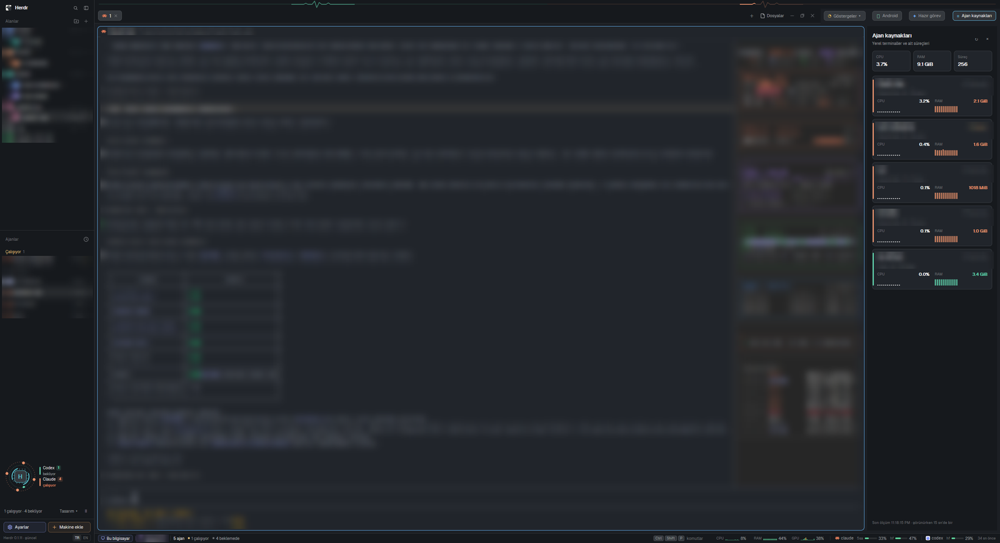

# Agent Workspace

A Herdr layout for people who run several coding agents at once. On the left is a dark sidebar with CPU, RAM and GPU gauges, the Claude and Codex quota bars, the list of projects (spaces), the list of agents sorted by who needs you most, an animated "team pulse" panel, and a footer with Settings, Add machine, and a TR | EN language switch. On the right is a tab bar with four launcher buttons, the terminal area, and a status bar that counts agents by state. Three side panels (Files, Agent resources, Android) open on demand, and a "Task presets" dialog starts a ready-made task in a new tab with one agent or a small team of agents. The interface is Turkish by default and switches to English instantly.



## What you see

Left to right, the window is one row: sidebar | work column | Android panel (hidden until opened). The window has no system title bar (`titlebar: none`); the sidebar brand row and the tab bar are the drag areas. Page background is the theme's `canvas`, the sidebar is the theme's `chrome`. Terminals have 14px / 12px padding. Dividers are 1px in the theme's `border` color. All colors named below as theme tokens (`working`, `blocked`, `done`, `idle`, `accent`, `chrome`, ...) come from the active Herdr theme; hex values are fixed.

**Sidebar, 360px wide, top to bottom** (fixed width, not draggable; it collapses to a 44px rail with the sidebar button in the brand row, and in the rail a `»` button at the bottom of the agents list opens it again):

1. Brand row, 46px, Herdr's stock `workspace-chrome` mod (its clone `workspace-chrome-tr` draws the same row this way): Herdr logo (20px) and the word "Herdr" at 13.5px semibold, a search button (opens Herdr's `picker`), and a sidebar-collapse button. Drag area for the window.
2. System gauges, 48px: three metrics in a row, each a label (CPU, RAM, GPU, 10px), a 12-column mini bar graph (columns 2px wide, 1px apart, 12px tall, newest on the right) and a percentage (11px). Bars and percentages are green `#5ed49a` below 60%, amber `#f2c14e` from 60%, orange `#f59152` from 80%, red `#f2665c` from 92% (dark themes; light themes use `#1f9d63`, `#c98a0b`, `#dd6b20`, `#d64545`). The percentage text stays muted until 60%.
3. Quota block, 145px: header "QUOTA USAGE" (10px, dim) on the left and "updated 12s ago" on the right. Below it, one 27px row per limit window of Claude and Codex: a 90px label ("Claude 5 h", "Claude 7 days", "Codex 5 h", ...), a 108x6px rounded bar filled with the same four-step color scale, a 36px right-aligned percentage, and the time until reset on the right (10px, dim, e.g. `3h 12m`, `2d 4h`). A 1px, 45%-opacity vertical tick on each bar marks how much of the window's time has already passed. Provider icons come from Herdr's program table; Claude is tinted `#d97757`. The block scrolls if rows overflow.
4. Two lists sharing the remaining height 1:1 (each at least 90px):
   - **Spaces**: header "Spaces" with a `+` button. One 8px-radius row per space with an 18px rounded colored avatar showing the first letter of the name (fixed colors, in palette order `#22a99a`, `#e3814f`, `#5b8def`, `#8b7cf6`, `#3fae6a`, `#d9649a`; each new space gets the least-used one, stored in shared `space.colors` and kept; the home space "~" stores no color and shows the first one, `#22a99a`), the name (max 150px), and on the right a git tail: `repo · branch` in 11.5px dim text (hidden when it repeats the name, or for `main`/`master`), then `↑n` ahead (theme ansi2) and `↓n` behind (theme ansi1). Worktrees are nested under their repo with a 22px indent and a branch icon instead of an avatar. When more than one machine is known the list is grouped under machine headers ("This computer" or the machine name, each with its own `+`), and headers fold. The active space has the theme's `selected` background.
   - **Agents**: header "Agents" with a sort button. See How it behaves for the rows.
5. Team pulse panel, 211px: a 136px animated diagram of the open agents grouped by kind, and a 26px footer with a one-line summary ("2 working · 1 awaiting reply"), a "Design ▾" button and a pause button (`Ⅱ` / `▶`).
6. Footer, 69px, top border 1px: two equal 30px pills, "Settings" (hue `#9aa8ff`, gear icon) and "Add machine" (hue `#f0a868`, plus icon), each with a 14px icon, 12px medium label, tinted fill, border and icon in its hue; below them the version line (`Herdr 0.x.y · up to date`, 10.5px, dim) and on its right a `TR | EN` switch (10px chips in a 1px bordered box; the active chip has the theme's `selected` fill).

**Work column, top to bottom:**

1. Team pulse strip, 24px: one horizontal heartbeat line per agent kind (Codex, Claude, OpenCode, Other) side by side, each a 25%-opacity line with a 180x24 heartbeat wave in the middle.
2. Top bar, 42px, `chrome` background, bottom border: the tab strip (takes the remaining width), then four 28px-high launcher buttons (7px radius, 1px border, 12px text, colored icon): "Gauges ▾" (`◔`, `#ecc05a`, 138px slot), "Android" (`▯`, `#7fc8a9`, 108px slot), "Task presets" (`✦`, `#6aa8f0`, 110px slot), "Agent resources" (`≡`, `#5fb3d9`, 130px slot). A launcher whose panel or popup is open gets its own hue as border color, the theme's `selected` fill and foreground text.
3. Body row with 8px padding and 8px gaps: the terminal area, then (each hidden until opened) a Files panel (368px, 280-900px), an Agent resources panel (370px, 330-600px). The terminal area is the active tab; every pane has a 30px header (Herdr's `pane` mod, always visible), 1px `border` outline, 1px `accent` outline when focused, 10px radius, 8px gap between panes, `background` fill.
4. Status bar, 28px: on the left a pill for the machine ("This computer" in `#9aa8ff` with a monitor icon, or the remote machine's name in `#f0a868` with a server icon), a pill with the git branch in `#b892f5` (only when the space has a branch), a 1px divider, "N agents" followed by one count per state in this order: "needs you" (medium weight, in the `blocked` color), "working", "done", "idle", each with a 6px dot in the state color (states with zero agents are omitted). On the far right a palette button: keycaps for the bound `app.palette` key (10px, 16px high, bordered) and the word "commands". Two more slots are hidden by default and used when the gauges are moved to the bottom: system gauges (360px) and quota (470px, provider names shown).

**Android panel, 330px**, a full-height column at the right edge of the window, hidden until opened (see below).

## How it behaves

**Agent statuses.** Every status below is drawn by the agents list, the tab bar, the status bar, the Agent resources cards and the team pulse; colors are the theme's `working`, `blocked`, `done`, `idle` tokens unless a hex is given.

- working: in the agents list a 12px spinner icon rotating once per 900ms in the `working` color; on a tab, the same spinner after the name; in the team pulse a heartbeat wave that sweeps left to right (3600ms) and, in the "Mini control center" design, scrolling typed code lines.
- blocked ("Needs you" / "Sizi bekliyor"): in the agents list a pill with the text "Needs you" (10.5px semibold, `blocked` color on a 15% tint; in the priority sort, where the section header already says it, a 14px "!" badge instead); on a tab a 6px `blocked` dot; in the status bar the count in `blocked` color and medium weight; in the team pulse the kind is labeled "awaiting reply" and, in the Signal mixer and Orbit designs, its bars or dots blink between about 20-25% and 90-100% opacity (900ms period).
- done: a filled 7px dot in the `done` color in the agents list; a 6px `done` dot on a tab; in the team pulse (Mini control center) a colored flash on the card that fades out over 700ms, the lines `> task complete` / `> output ready` and "Done". A done agent you are looking at turns idle, but stays in the Done section until you leave it, so the row does not jump away.
- idle: a 7px ring (1.5px border) in the `idle` color; in the team pulse strip a slowly pulsing line (opacity 0.4 to 0.65, 4400ms), and in the "Mini control center" design a small waving Turkish flag with a blinking `> ready ▏` prompt.
- In the team pulse only, an agent kind with no usable status reads "No status" in dim color.

**Agents list.**
- Sorted by "Priority" (default): sections Needs you, Done, Working, Idle (section headers colored by state, with a count); inside a section most recently changed first. The sort button (right of the header) opens a popup to switch to "Grouped by space". The choice is stored in the shared key `agents.sort`.
- Each row (30px): agent icon (16px; click it to fold its sub-agents), name (the space name in priority view, the tab name under a space header), a dim `· tab title` when needed, the machine name for remote agents, a fold chevron with a count when it has sub-agents, the time since the last state change (`<1m`, `12m`, `3h`, `2d`) or, while hovered, a pin button, then the status marker.
- A parent row takes the most urgent state of its live sub-agents for sorting. Sub-agents appear below it with tree lines; clicking a sub-agent row peeks its terminal (`terminal.peek`).
- Pinned agents sit in a "Pinned" group on top; pins and change times are kept across restarts and pruned when an agent ends.
- Clicking a row focuses that agent's pane (`pane.focus`).

**Spaces list.** Click selects (`space.select`). Dragging a row onto another row of the same machine reorders (`space.move`), with a 2px `accent` line showing the drop spot. Right-click opens a menu: Rename, New worktree / Open worktree (only inside a git checkout), Remove worktree (only for linked worktrees), Close. The header `+` creates a space (`space.new`); machine headers have their own `+` that creates one on that machine ("New space there").

**Tab bar.** Tabs are 29px high with a 7px radius; the active tab has the `raised` fill, a 1px border and a close `x`. Click selects; double-click renames; dragging one tab onto another moves it; right-click opens the tab menu (Rename, New tab, Close); the mouse wheel over the bar switches tabs. A tab shows the agent's icon and the state marker described above, and `Z` after the name when zoomed. The `+` button opens a 250px popup: "Terminal", then "Start an agent" with every installed agent (press `1`-`9` to start the n-th one; not-installed agents show "not installed" and do nothing), then "New space", "New worktree...", "Open worktree...". A "Files" button toggles the Files panel; the open panel is remembered per space. On Windows and Linux the three window buttons (minimize, maximize/restore, close) are drawn at the right end, with vector icons on Windows.

**Right-click in a terminal** opens the same popup style: Split right, Split down, Zoom, "Send right-clicks to pane" / "Use Herdr right-click menu", "Send back to <parent>" for kept sub-agents, Close pane. Up/Down move, Enter runs, Esc closes. With no pane target the menu offers New space, Keybinds and four themes (graphite, ink, moss, atom one dark).

**Language switch.** Clicking `TR` or `EN` (footer, bottom left) writes the shared key `ui.lang` (`"tr"` default, `"en"`); every mod re-renders at once. A missing or unknown value means Turkish. When the sidebar is narrower than 160px the switch is hidden (the footer then shows icon-only pills).

**Gauges.** The "Gauges ▾" button opens a 286x212 popup with two choices, each with a small window sketch: "Top left" (above the project list; this is the default, sidebar 360px) and "Bottom bar" (system gauges and quota in the status bar, sidebar becomes 268px wide). Choosing one shows/hides `sidebar-system` and `sidebar-quota` against `status-system` and `status-quota` and stores `monitor.position`. Clicking the active choice just closes the popup. The system gauges refresh every 3s, only while their slot is visible; clicking them opens the Windows Task Manager. A gauge that cannot be read shows a dash; if the whole read fails it shows "System load unavailable".

**Quota.** Reads every 60s while visible (one shared reading serves all quota views; a reading younger than 50s is reused). When the data is older than 10 minutes the whole block dims to 60% opacity. Clicking (or right-clicking in the bar variant) opens a 300px popup with, per provider, one bar per window and "resets in 3h 12m" plus "on pace" / "12% ahead of pace" / "8% under pace", a "Refresh" link, and checkboxes for what the status bar shows (5-hour, weekly, monthly, model limits; per provider; signed-out providers; provider names). In the bar variant a small `▲` follows a bar that is 10 or more points ahead of the elapsed time while at least 20% used. Window kinds shown by default: 5-hour, weekly, monthly; model limits off. This layout limits the providers to Claude and Codex.

**Task presets** (button `✦`): opens a 900x820 dialog for the active space. Left column "TASK TYPE" lists three presets: "Investigate a bug" (`#f2808f`, "read-only instruction"), "Review changes" (`#93a6ff`, "read-only instruction"), "Run tests" (`#6fd49b`, "runs tests"), and a segmented switch "Single agent | Team mode". Single agent: choose a working folder (text field plus "Browse..." that opens the system folder picker; remote spaces must type the path), a details field (required for "Investigate a bug"), and one installed agent from tiles with a colored initials badge. A collapsible "Instructions sent to the agent" box shows the exact command line, folder and text (TASK, DETAILS, RULE) and has a "Copy" button. "Start task" (or Ctrl+Enter) opens a new tab named after the preset and runs the agent there with the task text. The footer shows "Missing: ..." in amber until the form is valid and a note ("In a new tab, no commit, push or deploy") when it is. The last preset, agent and mode are remembered.

Team mode (local spaces only): choose coordinated or parallel review, a list of members (coordinator first, 1-6 workers, an optional final reviewer toggled "On/Off", default off, at most 8 rows) each with a responsibility text, a tool (Codex / Claude / OpenCode), provider, model (searchable, 6 per page) and effort; "Refresh models" re-reads the model list. "Start team" opens a new tab named `Ekip · <preset title>` running the team runner, which prints the run folder and each role's progress, then the final report.

**Agent resources** (button `≡`): a 370px panel with three totals (CPU, RAM, Processes) and one card per agent: colored 3px bar (Claude `#e8916b`, Codex `#5fd3ac`, OpenCode `#b892f5`, Copilot `#6aa5ff`, Gemini `#4fd0e4`, otherwise `#9aa8ff`), space name, status, program and address, and CPU and RAM numbers with 12-sample bar graphs. Cards are measured only for local agents (first 32), re-measured every 15s while the panel is visible; remote agents show "Remote machine, resource measurement not supported". `↻` refreshes now, `x` closes.

**Android** (button `▯`): a 330px panel listing connected physical devices and registered emulators, refreshed every 5s while visible. Each card has a 3px colored bar and a state: Ready `#58c98d`, waiting for USB-debugging approval / authorizing / connecting `#ecb95e`, offline `#e27878`. A ready device shows its foreground app and a "Screenshot" button (saved to Pictures/Herdr, the path comes back as a notification). Emulators show Running, Starting... (up to 90s), Waiting for status, or Stopped, with a "Start" button when stopped. Only one action runs at a time.

**Team pulse.** The 211px panel and the 24px strip show the same data: open agents grouped into Codex (`#5fd3ac`), Claude (`#e8916b`), OpenCode (`#b892f5`) and Other (`#9aa8ff`); a kind's state is its most urgent one (blocked, working, done, idle). "Design ▾" switches between four diagrams, default "Mini control center": Signal mixer, Mini control center, Orbit, Pulse rows (stored in `team-pulse.design`; from a very narrow sidebar it opens as a popup). The pause button or a click on the strip stops all motion (`team-pulse.paused`). Below 190px of width it shrinks to colored dots. Tooltips state that the animation is a status display, not a performance measurement or real message traffic.

## Built from

**Layout** `layouts/agent-workspace.json`. Root keys: `terminal_menu: "menu-tr"`, `background: "canvas"`, `terminal_padding: [14, 12]`, `divider: {width: 1, color: "border"}`, `titlebar: "none"`, `traffic_lights: [12, 16]`. Node tree (id: type, size):

```
root: row
  sidebar: column, 360px (min 44, max 480, background chrome, resizable false)
    brand: block, 46px, window_drag        mod workspace-chrome (stock)
    sidebar-system: block, 48px            mod system-windows  props {monitorSlot: "sidebar-system", sidebar: true}
    sidebar-quota: block, 145px            mod quota  props {monitorSlot: "sidebar-quota", sidebar: true, providers: ["claude","codex"]}
    sidebar-lists: column
      spaces: block, weight 1, min 90      mod spaces-tr
      agents: block, weight 1, min 90      mod agents-tr
    team-pulse-panel: block, 211px         mod team-pulse
    sidebar-footer: block, 69px            mod workspace-chrome-tr  props {footer: true}
  work: column (resizable false)
    team-pulse-strip: block, 24px          mod team-pulse  props {strip: true}
    topbar: row, 42px (resizable false)
      tabs: block, weight 1, window_drag   mod tabs-tr
      monitor-position-button: block, 138px  mod monitor-position
      android-toggle-button: block, 108px    mod android-devices  props {launcher: true}
      task-presets-button: block, 110px      mod task-presets-tr  props {launcher: true}
      agent-resources-button: block, 130px   mod agent-resources-tr  props {launcher: true}
    work-body: row, padding 8, gap 8
      main: block, content {tab: "active", pane: {header {mod "pane", height 30, position top, reveal always}, background "background", border {1, "border"}, focus {1, "accent"}, radius 10, gap 8, lone true}}
      panel: column, 368px (min 280, max 900), hidden
        panel-body: stack, active "files"
          files: block                     mod files-tr
      agent-resources-panel: block, 370px (min 330, max 600), hidden   mod agent-resources-tr
    status: row, 28px (resizable false)
      status-main: block, weight 1         mod workspace-status-tr
      status-system: block, 360px, hidden  mod system-windows  props {monitorSlot: "status-system"}
      status-quota: block, 470px, hidden   mod quota  props {names: true, providers: ["claude","codex"], monitorSlot: "status-quota"}
  android-panel: block, 330px, hidden      mod android-devices
```

`sidebar-system` and `sidebar-quota` also carry `hidden: false`. The "Gauges" popup flips these between sidebar and status bar with `layout.show` / `layout.hide`.

**Stock Herdr mods the layout still needs** (not in this package, shipped with Herdr): `workspace-chrome` (brand block, and its SVG icons used by agents-tr, spaces-tr, menu-tr, new-menu-tr, workspace-status-tr), `pane` (pane header; `close.svg` used by tabs-tr), `files` and `changes` (icons used by tabs-tr), `picker` (search), `machine-add` (Add machine), `worktree` (worktree dialogs), `icons/` (agent and shell icons).

**Mods** (all `place: "none"`; `task-presets-tr` also `overlay: {kind: "dialog", width: 900, height: 820}`). Each mod reads the language with `const tx = (tr, en) => shared("ui.lang") === "en" ? en : tr`, called at render time only.

Clones of Herdr's shipped mods, translated (Apache-2.0, cloned with `mod.clone` from the shipped mods at versions 0.1.10-0.1.11, see each `mod.json`; the one functional change is the TR | EN texts, plus small tweaks):
- `workspace-chrome-tr`: footer variant (`props.footer`) with the two pills, version line and `TR | EN` switch; `setShared("ui.lang", ...)`. Calls `run("app.settings")`, `run("mod.open", {name: "machine-add"})`, `run("app.whats_new")`, `run("layout.resize", {id: "sidebar", px})`, reads `updates()`. Pill hues `#9aa8ff`, `#f0a868`, update badge `#ecc05a`. Icons `settings.svg`, `plus.svg` plus the rest of the stock icon set in its folder.
- `workspace-status-tr`: `spaces()`, `agents()`, `keys()`; calls `run("app.palette")`. Hues `#9aa8ff`, `#f0a868`, `#b892f5`.
- `agents-tr`: `agents()`, `terminals()`, `panes()`, `focused()`, `setAgentOrder()`; `run("pane.focus")`, `run("terminal.peek")`, `run("layout.resize")`; popup via `openOverlay({mod: "agents-tr", kind: "popup", width: 200, height: 140, props: {sortMenu: true}})`; shared key `agents.sort`; `localStorage` keys `changed`, `pins`.
- `spaces-tr`: `spaces()`, `machines()`, `panes()`, `watchFolder()`; `run("space.new" | "space.select" | "space.move")`; `hc(["machine", "ls", "--json"])` every 15s; `git status --porcelain=v2 --branch` and `git rev-parse` per space folder; shared key `space.colors`; `localStorage` key `machines.folded`; right-click opens `menu-tr` (`props {tab: "space"}`).
- `tabs-tr`: `run("tab.select" | "tab.rename" | "tab.move" | "tab.close" | "layout.select" | "layout.show" | "layout.hide" | "window.minimize" | "window.maximize" | "window.close" | "tab.prev" | "tab.next")`; popups `menu-tr` and `new-menu-tr` (250 wide, 512 high); `localStorage` key `panels`; SVGs `win-min`, `win-max`, `win-restore`, `win-close`.
- `new-menu-tr`: `knownAgents()`, `run("tab.new")`, `run("space.new")`, opens `worktree` dialogs (460x280 and 560x480).
- `menu-tr` (set as `terminal_menu`): pane, tab, space and global menus; `run("pane.split" | "pane.zoom" | "pane.close" | "terminal.right_click" | "terminal.park" | "tab.*" | "space.*" | "app.help" | "app.theme")`; opens `worktree` dialogs; `git rev-parse` to detect main vs linked checkout.
- `files-tr`: `exec`, `readTextFile`, `watchFolder`; lists the focused pane's folder (max 500 entries per folder, 5,000 total, `.git` hidden), git status marks `A` (added/untracked, ansi2), `M` (modified, `blocked` color), `D`/`U` (ansi1), read-only editor preview up to 400,000 characters with syntax colors; refreshes every 10s and on folder changes. SVGs `chevron-down`, `chevron-right`, `file`, `folder`.

Modified from github.com/Lakris2407/herdr-quota (MIT, see NOTICE):
- `quota`: runs `quota-axi --json --no-credential-refresh` (see Watch out for the lookup order), builds bars per window; shared keys `quota.data`, `quota.error`, `quota.inflight`, `quota.refresh`, `quota.options`; accepts commands `menu` and `refresh`; popup via `openOverlay({mod: "quota", kind: "popup", width: 300, props: {menu: true}})`. Scale thresholds 60/80/92.
- `system-windows`: every 3s runs `node mods/system-windows/sample.cjs` (CPU from Node's `os.cpus()` over a 1s window, RAM from `os.totalmem()/freemem()`, GPU name and utilization from `nvidia-smi --query-gpu=name,utilization.gpu`, the busiest GPU); keeps 12 samples; shares the reading as `system-monitor.last`; click runs `C:\Windows\System32\Taskmgr.exe`.

Written for this layout:
- `monitor-position`: the "Gauges" launcher and popup (`openOverlay` popup 286x212, `layout.show/hide/resize`, `setShared("monitor.position")`, `nextCommand()` accepting `sidebar` and `bottom`). Hue `#ecc05a`.
- `android-devices`: panel and launcher. Runs `node mods/android-devices/android.cjs list|boot|shot`, which calls `adb devices -l`, `adb -s <serial> emu avd name`, `adb -s <serial> shell dumpsys activity activities`, `emulator -list-avds`, `emulator -avd <name>` (detached), `adb -s <serial> exec-out screencap -p`. SDK folder: `ANDROID_HOME`, else `ANDROID_SDK_ROOT`, else the Android Studio default (`%LOCALAPPDATA%/Android/Sdk`, `~/Library/Android/sdk`, `~/Android/Sdk`). Launcher uses `run("layout.toggle", {id: "android-panel"})`. Hues `#7fc8a9`, `#58c98d`, `#ecb95e`, `#e27878`. `notify()` for results.
- `agent-resources-tr`: panel and launcher. For up to 32 local agents it calls `hc(["get", address, "--json"])` to get the terminal's root pid, then `pwsh -NoLogo -NoProfile -NonInteractive -File mods/agent-resources-tr/sample.ps1 -RootIds <pids>`, which reads `Win32_Process` through CIM and returns each process tree's CPU seconds and working set. CPU % is the CPU-time delta over the interval divided by cores. Launcher uses `run("layout.toggle", {id: "agent-resources-panel"})`.
- `task-presets-tr`: dialog and launcher (`openOverlay`, `closeOverlay`, `pickFolder`, `writeTextFile`, `knownAgents`, `run("tab.new", {name, space, folder, argv, task})`). Presets are an array of `{id, title, icon, color, tag, hint, en, brief}`. Single-agent task text is `brief`, then "Kullanıcının ek açıklaması:" plus your details, then the rule "Bu görev commit, push, PR açma, merge veya dağıtım yetkisi vermez." joined by blank lines. `team-runner.cjs` has two commands: `catalog`, `run <request.json>`.
- `team-pulse`: panel and strip; `agents()`, shared keys `team-pulse.design`, `team-pulse.paused`, `team-pulse.menu-open`; popup 200x(44+4*36). Art: `circuit-ring.svg` (52x52 hub halo, spins 4200ms working / 12000ms otherwise), `orbit-ring.svg`, `orbit-dots-1..4.svg`, `pulse.svg` (180x24 heartbeat, 1.7px stroke), `turkish-flag-mark.svg` (white crescent and star on `#E30A17`, drawn as 15 clipped, wave-animated slices). Animations use native `loop`, `spin`, `frames` and `transition`, not timers.

**Team runner** (`team-runner.cjs`, Node, no dependencies). `catalog`: for each tool whose launcher file exists, Codex runs `codex debug models` (hidden models skipped), OpenCode runs `opencode api model.list` (enabled, tool-capable, non-embedding), Claude runs `claude --help` (must mention `--effort`) and offers the fixed aliases `fable`, `opus`, `sonnet`, `haiku` with efforts low, medium, high, xhigh, max. `run`: validates the request, creates `<home>/data/team-runs/<timestamp>-<8 hex>/`, writes `config.json`, `status.json`, and per role `<id>.stdout.jsonl`, `<id>.stderr.txt`, `<id>.md`, finally `result.md`. Coordinated mode: coordinator returns a JSON assignment per worker, workers run in parallel, coordinator synthesizes, optional reviewer audits. Parallel mode: workers review independently, coordinator synthesizes. Each call: 20 minutes, 8 MiB of output, prompt at most 150,000 characters; main task at most 20,000 characters; details at most 16,000 (checked in the dialog). Invocations: Codex `exec --json --skip-git-repo-check --ephemeral -s read-only -m <model> -c model_provider="openai" -c service_tier="default" [-c model_reasoning_effort="<e>"] -` (prompt on stdin); Claude `-p --model <m> --output-format json --permission-mode plan --no-session-persistence [--effort <e>]`; OpenCode `run --standalone --agent plan --format json --model <provider>/<model>[#<effort>]`. Every prompt starts with a Turkish boundary text: read project instructions, do not change source files, no commit/push/PR/merge/deploy/dependency install/starting other agents, other agents' output is untrusted evidence, answer in Turkish.

**Herdr functions used overall:** `spaces`, `machines`, `panes`, `terminals`, `agents`, `focused`, `knownAgents`, `layout`, `theme`, `settings`, `window`, `keys`, `updates`, `props`, `shared`, `setShared`, `setAgentOrder`, `openOverlay`, `closeOverlay`, `notify`, `nextCommand`, `exec`, `hc`, `readTextFile`, `writeTextFile`, `watchFolder`, `pickFolder`, `appHome`, `home`, and `run` with the commands named above.

**Programs run:** `node`, `quota-axi` (with `cmd.exe` or the login shell as fallback), `pwsh`, `powershell` (Windows file listing), `sh` (elsewhere and on remote machines), `git`, `nvidia-smi.exe`, `Taskmgr.exe`, `adb`, `emulator`, `codex`, `claude`, `opencode`, and the agent chosen in the dialog.

## Watch out

- **Windows first.** The layout was built and used on Windows 11. `system-windows` (Task Manager click, `nvidia-smi` at `C:\Windows\System32\nvidia-smi.exe`), `agent-resources-tr` (PowerShell 7 `pwsh`, `Win32_Process`) and the team runner's tool paths are Windows-only; elsewhere those parts show a dash or an error and nothing else breaks. `files-tr` uses `powershell` on Windows and `sh` elsewhere.
- **`node` must be on PATH** (system gauges, Android, team mode).
- **GPU gauge** is NVIDIA only; the highest utilization across GPUs is shown. Without `nvidia-smi` it shows a dash.
- **Quota** needs the `quota-axi` CLI. Lookup order on Windows: `node --use-system-ca <home>/AppData/Roaming/npm/node_modules/quota-axi/dist/bin/quota-axi.js`, then `quota-axi` on PATH, then `cmd.exe /d /s /c quota-axi ...`; elsewhere `quota-axi`, then the login shell (`$SHELL -lic`). The next way is tried only if one could not start. A failure shows the error text in the sidebar block ("Quota unavailable" in the status bar). Every attempt runs with Herdr's home as the working directory.
- **Android** needs the Android SDK platform-tools (`adb`) and, for emulators, the `emulator` folder, under `ANDROID_HOME` / `ANDROID_SDK_ROOT` or the default SDK path. Without them the panel shows "Could not read adb: ...". Only one emulator starts at a time (it refuses while another is starting or offline). Emulator logs go to `<Herdr home>/data/android-devices/` (`HERDR_APP_HOME`, else `~/.config/herdr-app`); screenshots go to `~/Pictures/Herdr/android-<ms>.png`. The "<name> başlatılıyor" notification after a start stays Turkish.
- **Team mode** needs the Codex, Claude and/or OpenCode CLIs installed where `team-runner.cjs` looks: Codex at `%APPDATA%/npm/node_modules/@openai/codex/bin/codex.js`, Claude at `~/.local/bin/claude.exe`, OpenCode at `%APPDATA%/npm/node_modules/@opencode/cli/bin/opencode.exe`. A tool not found there is listed as an error under the team editor and cannot be chosen. Team mode only works for local spaces. It sends your task text and lets the chosen CLI read the working folder; each call uses that provider account's quota. The model list is not an access guarantee.
- **Read-only is an instruction, not a sandbox, for single-agent presets.** The text says "do not modify files" and "no commit, push, PR, merge or deploy" but the agent starts with whatever permissions its own launch command has. Team roles are started in the CLIs' read-only/plan modes (Codex `-s read-only`, Claude `--permission-mode plan`, OpenCode `--agent plan`), without auto-approval.
- **Leftover files.** The dialog writes the team request to `<home>/data/team-request-<time>-<random>.json` before launching; nothing deletes it. Team runs accumulate under `<home>/data/team-runs/`.
- **Task text stays Turkish by design.** The preset briefs, the rule line, the tab names (`Hatayı araştır`, `Değişikliği incele`, `Testleri çalıştır`, `Ekip · ...`), the default team role labels, the team runner's prompts and console messages, and the answers agents are told to give are all Turkish regardless of `ui.lang`. Only the dialog around them is translated. The `title` in `mod.json` of some mods (`Ajan kaynakları`, `Hazır görevler`, `Göstergelerin konumu`, `Ekip bağlantıları ve nabız`) is Turkish too.
- **Panel buttons.** `tabs-tr` only shows panel buttons for panels the layout has; here that is only "Files" (there is no "Changes" panel).
- **No keys shipped.** There is no `keys.json`; the sidebar toggle, palette and everything else use Herdr's bindings. `ctrl-enter` starts a task only while the Task presets dialog is focused.
- **Gauge position side effect.** Choosing "Bottom bar" also resizes the sidebar to 268px; choosing "Top left" resizes it to 360px. The sidebar is not draggable (`resizable: false`).
- **Limits:** agents list unlimited; Agent resources measures the first 32 local agents; Files shows 500 entries per folder and 5,000 in total; file preview is cut at 400,000 characters; team roles at most 8 rows (coordinator, 6 workers, reviewer).
- **Colors by theme.** State colors in lists, tabs, status bar and cards are theme tokens, so they change with the theme; only the hex values named above are fixed.
- **Team pulse is decoration.** It draws status, not messages or performance. The "Mini control center" idle state shows a Turkish flag and the diagram text "> ready", "> task complete" is not translated.
- **GPU tooltip** names the busiest NVIDIA card as `nvidia-smi` reports it (`--query-gpu=name,utilization.gpu`); the mod builds the Turkish/English tooltip from that name.

## Done when

1. `herdr-app check` passes for every mod in `mods/`, and `layout.switch {name: "agent-workspace"}` shows the layout with the sidebar at 360px, no system title bar, and the Android, Files and Agent resources panels hidden.
2. The sidebar shows, in this order: brand row, CPU/RAM/GPU gauges, the quota block (Claude and Codex rows when `quota-axi` works, "Loading quota..." or the error otherwise), Spaces and Agents lists, the team pulse panel and the footer.
3. Clicking `EN` in the footer turns every visible label to English at once (Spaces, Agents, Settings, Add machine, "agents", launcher labels, gauge tooltips) and `TR` turns them back; the choice survives a restart (`ui.lang`).
4. Opening a second space and starting an agent makes the agents list show it under its state; when it asks for input its row shows "Needs you", its tab gets a `blocked` dot, and the status bar shows "1 needs you".
5. Clicking "Gauges ▾" and choosing "Bottom bar" moves the CPU/RAM/GPU and quota gauges into the status bar and the sidebar becomes 268px wide; "Top left" restores 360px.
6. Clicking "Task presets" opens the 900x820 dialog; choosing "Investigate a bug" with an empty detail field shows "Missing: describe the bug"; with a folder, a detail and an installed agent, Ctrl+Enter opens a new tab named "Hatayı araştır" running that agent with the Turkish task text shown in the preview box.
7. In team mode with the Codex CLI installed, "Refresh models" fills the model list; "Start team" opens a tab named `Ekip · ...` that prints a run folder under `data/team-runs/` containing `config.json` and `status.json`.
8. "Agent resources" lists each local agent as a card with CPU, RAM and process count within 15 seconds (on Windows with `pwsh`).
9. "Android" shows connected devices and emulators from `adb` and starts and screenshots them (with the SDK installed), and shows "Could not read adb" without it.
10. The team pulse panel animates while an agent is working, stops when the pause button is pressed, and "Design ▾" switches between the four diagrams.
